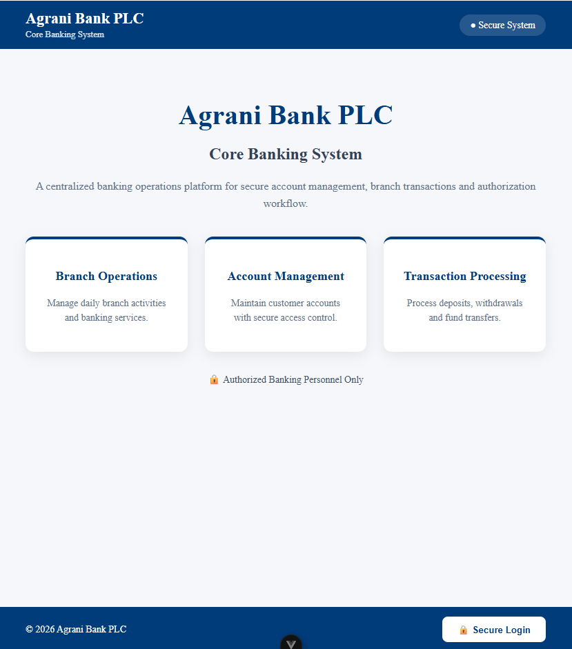
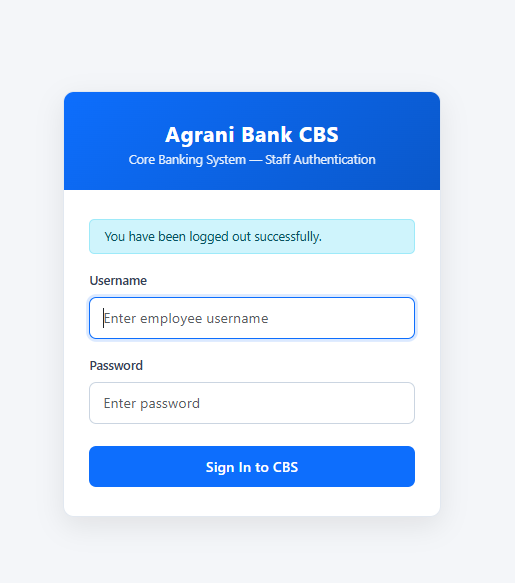
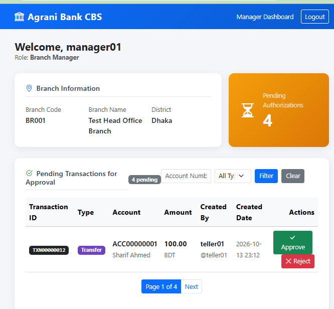
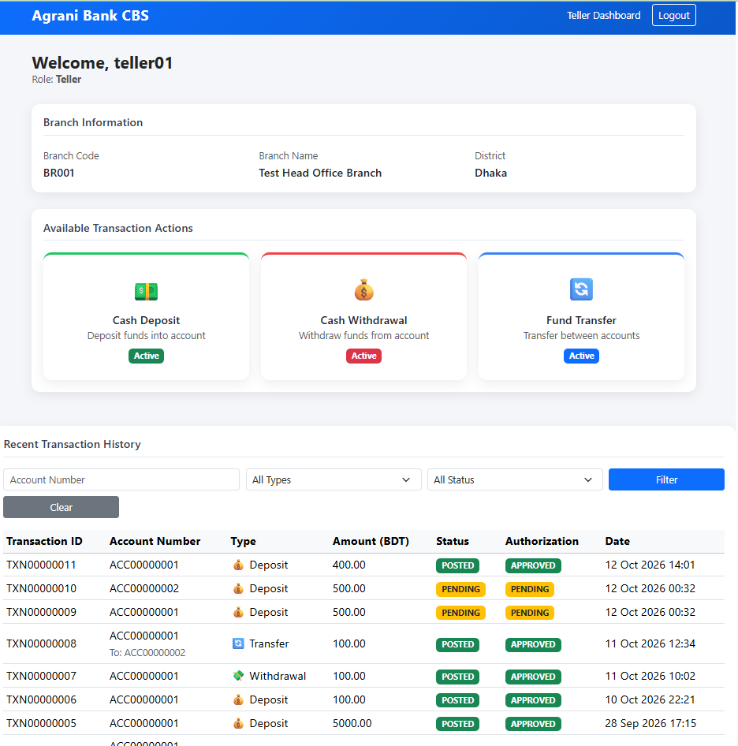

# Agrani Bank Core Banking System (CBS) — Prototype

[](https://github.com/sanjid-hasan307/agrani-cbs-prototype)

> **Development prototype:** This internship project demonstrates selected core-banking workflows using demonstration and locally configured data. It is not a production banking platform and must not be used to process real customer information or financial transactions.

Repository: [sanjid-hasan307/agrani-cbs-prototype](https://github.com/sanjid-hasan307/agrani-cbs-prototype)

## Overview

This modular Django application models branches, staff, customers, account products, and accounts. It implements Teller-initiated deposit, withdrawal, and transfer requests, with a separate Manager maker-checker approval workflow. Django-rendered dashboards provide the implemented Teller, Manager, and Auditor views. A Django REST Framework API and a separate, developing Vue 3 frontend are also included.

Transactions are created as pending requests. Manager approval posts an eligible transaction and updates account balances; rejection leaves balances unchanged. The backend is configured for PostgreSQL and uses Django sessions for staff authentication.

## Implemented Features

- Branch, staff profile, customer, account product, and account records.
- Teller deposit, withdrawal, and internal transfer requests.
- Manager review and approval or rejection of pending transactions.
- Debit/credit transaction entries with balance validation.
- Decimal monetary amounts, atomic transaction services, and row locking during posting.
- Django Group role checks and branch-access checks in the relevant Teller services and Django Manager dashboard actions.
- Audit-log records for transaction initiation and Manager approval or rejection.
- Django REST Framework login, session-check, and transaction API views.
- Django-rendered staff login and dashboards; the Vue client remains in development.

## Technology Stack

| Area | Technologies |
| --- | --- |
| Backend | Python, Django 6.1.1, Django REST Framework 3.18.1 |
| Database | PostgreSQL, through `psycopg2-binary` |
| Frontend | Vue 3, Vite, Vue Router, Pinia, Axios |
| Django-rendered UI | HTML, CSS, Bootstrap, Django templates |
| Authentication | Django authentication and session-based sign-in |

The frontend package declares Node.js `^22.18.0` or `>=24.12.0`.

## System Architecture

```text
Django templates -> Django views -> transaction services -> PostgreSQL
Vue 3 + Vite     -> Django APIs  -> views/services        -> PostgreSQL
```

The Django project is divided into apps for core banking records, users, transactions, and audit logs. Transaction business operations are organized in `transactions/services/`. Django templates provide the implemented role dashboards. The Vue application in `frontend/` is a separate client and does not replace those dashboards.

### API routes

The following routes are wired in the Django URL configuration:

| Method | Path | Purpose |
| --- | --- | --- |
| `POST` | `/api/login/` | Authenticate and establish a Django session |
| `GET` | `/api/csrf/` | Set the CSRF cookie |
| `GET` | `/api/manager/session/` | Check the current session's Manager role |
| `POST` | `/api/transactions/deposit/` | Submit a deposit request |
| `POST` | `/api/transactions/withdraw/` | Submit a withdrawal request |
| `POST` | `/api/transactions/transfer/` | Submit a transfer request |
| `POST` | `/api/transactions/<pk>/approve/` | Approve a transaction |
| `POST` | `/api/transactions/<pk>/reject/` | Reject a transaction |

The transaction submission services create pending requests; they do not post balances at creation.

## Role-Based Workflows

### Teller

The Django Teller dashboard is restricted to users in the Teller group. Tellers can submit deposit, withdrawal, and transfer requests, and view their own recent transactions with account-number, transaction-type, and status filters. Teller operations use service-level checks to restrict account access to the staff member's branch, except for the implemented superuser bypass.

### Manager

The Django Manager dashboard shows pending requests for the Manager's branch and supports account-number and transaction-type filtering. Managers can approve or reject requests through the dashboard. A maker cannot approve or reject their own request. Approval posts the transaction and applies its balance changes; rejection records an optional reason and does not change balances.

### Auditor

The Django Auditor dashboard displays the signed-in staff member and available branch information. Transaction-log review, user activity reports, and reconciliation reports are placeholders marked as coming soon; those Auditor reporting workflows are not implemented.

### Vue frontend status

The Vue application has a landing page and login flow. Its early Manager dashboard checks the session and role, then displays an under-development notice; it is not the completed Manager transaction dashboard. The Teller, Manager approval/rejection, and Auditor workflows described above are Django template workflows.

## Project Structure

```text
.
├── accounts/                 # Account model and tests
├── audit/                    # Audit-log model and tests
├── branches/                 # Branch model and tests
├── config/                   # Django settings and root URL configuration
├── core_api/                 # Login, CSRF, and Manager-session API
├── customers/                # Customer model and tests
├── products/                 # Account product model and tests
├── transactions/
│   ├── services/             # Deposit, withdrawal, transfer, authorization, posting
│   ├── models.py             # Transactions and debit/credit entries
│   ├── serializers.py        # Transaction request validation
│   ├── urls.py
│   └── views.py              # Transaction API views
├── users/
│   ├── services/             # Branch permission helpers
│   ├── templates/users/      # Django login and role dashboards
│   ├── dashboard_views.py    # Django dashboard workflows
│   ├── models.py             # Staff profiles
│   └── views.py              # Session login and logout
├── frontend/                 # Separate Vue 3 + Vite application
├── manage.py
└── requirements.txt
```

## Local Development

### Prerequisites

- Python and pip compatible with the pinned packages in `requirements.txt`.
- PostgreSQL available locally.
- Node.js and npm meeting the frontend package's engine requirement above.

### Backend setup (Windows PowerShell)

Run from the repository root:

```powershell
py -m venv .venv
.\.venv\Scripts\Activate.ps1
python -m pip install -r requirements.txt
Copy-Item .env.example .env
```

Create a local PostgreSQL database and configure the copied `.env` for your development environment. The checked-in `.env.example` contains placeholders; do not commit local credentials or secrets.

Apply migrations and create a local administrator account:

```powershell
python manage.py migrate
python manage.py createsuperuser
```

Start the Django development server:

```powershell
python manage.py runserver
```

To try role dashboards, configure local branches, staff profiles, and Django role groups with demonstration data. No shared demo credentials are provided.

### Vue frontend

In another terminal, run:

```powershell
Set-Location frontend
npm install
npm run dev
```

Vite runs separately from Django. The current Vue API client points to the local backend at `http://localhost:8000/api`.

### Checks and tests

From the repository root, with the Python environment active:

```powershell
python manage.py check
python manage.py test
```

From `frontend/`, the available build and preview commands are:

```powershell
npm run build
npm run preview
```

The repository contains Django tests for models, services, permissions, and dashboard behavior. No test coverage percentage is claimed.

## Security Implementation and Limitations

Django authentication and session middleware support staff sign-in. Django-rendered forms include CSRF tokens; the Vue API client sends cookies and the CSRF header. Django Groups support role checks. Teller service operations and Django Manager dashboard actions include branch-access checks, while Manager authorization enforces the maker-checker rule. Transaction services use atomic database blocks, `Decimal` amounts, debit/credit validation, and row locking during posting. Transaction initiation and Manager authorization actions are recorded in audit logs.

These are prototype application controls, not a security certification or production security assessment. The checked-in settings default to debug mode and a permissive host configuration, so they are not suitable for production. Do not use real credentials, customer data, or funds. Production use would require a dedicated security review, hardened environment-specific settings, operational controls, and applicable organizational and regulatory approval.

## Screenshots
### CBS Landing Page



### Secure Login Modal



### Vue Manager Dashboard



### Django Teller Dashboard




Screenshots will be added when the interfaces are prepared for portfolio presentation.

- Django Teller dashboard — *Screenshot to be added*
- Django Manager dashboard — *Screenshot to be added*
- Django Auditor dashboard — *Screenshot to be added*
- Vue frontend — *Screenshot to be added*

## Future Improvements

- Complete the Vue role workflows and integrate them with the backend operations.
- Implement Auditor transaction review, staff activity history, and reconciliation reporting.
- Expand operational, authorization, and integration tests as workflows evolve.
- Harden settings, access controls, monitoring, and operational procedures before any production consideration.
- Document a safe, repeatable way to prepare local demonstration data.
